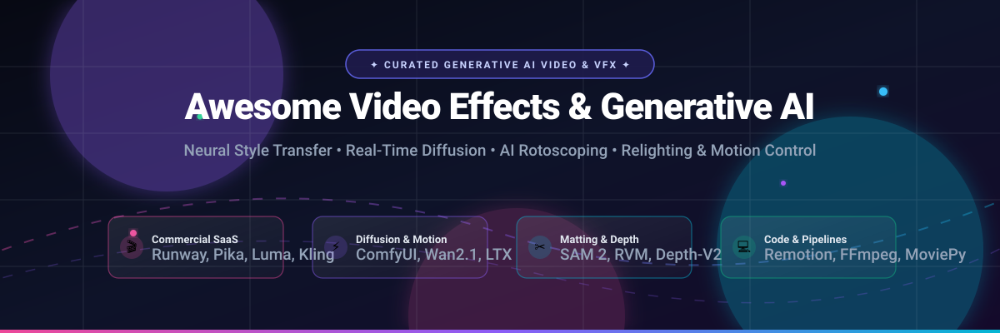

# 🎬 Awesome Video Effects & Generative AI Visuals 🚀

  
  
  
  
  
  
  

**A comprehensive, curated collection of commercial SaaS platforms, foundation video diffusion models, neural VFX pipelines, video-to-video restyling, automated AI rotoscoping, camera control, and programmatic visual effects engines.**

*Last updated: November 2026* 🌟 Star this repository if you find it valuable! 🌟

---

## 📌 Table of Contents

- [🌐 Sector Overview & Market Dynamics](#-sector-overview--market-dynamics)
- [🏢 SaaS & Hosted Commercial Platforms](#-saas--hosted-commercial-platforms)
- [💻 Open-Source GitHub Projects](#-open-source-github-projects)
  - [⚡ Top Open-Source Repositories (Ranked by Stars)](#-top-open-source-repositories-ranked-by-stars)
- [🔍 SEO Search Keywords & Topic Taxonomy](#-seo-search-keywords--topic-taxonomy)
- [🤝 How to Contribute](#-how-to-contribute)
- [💖 Support](#-support)
- [⭐ Star History](#-star-history)
- [⚖️ Disclaimer & License](#️-disclaimer--license)

---

## 🌐 Sector Overview & Market Dynamics

The global market for Generative AI in video effects and video production is estimated at **$1.8 billion to $2.4 billion in 2026**, on pace to exceed **$8.5 billion by 2030** at an annual growth rate (CAGR) of over **34%**. 

The sector currently exhibits **moderate fragmentation with rapid consolidation pressure at the foundation layer**:
- At the **foundational model & compute tier**, capital intensity favours well-funded players (Runway, Kling / Kuaishou, Luma AI, Pika, and Autodesk/Wonder Dynamics), resulting in oligopolistic tendencies for high-tier multimodal cinematic synthesis.
- Simultaneously, at the **creator tooling, specialized VFX workflows, and post-production layer**, the ecosystem remains **vibrantly fragmented**, propelled by the open-source community around ComfyUI, Apache-licensed foundation models (Wan2.1, LTX-Video, SAM 2), modular ControlNet extensions, and programmatic render engines. Commercial suites compete aggressively on workflow integration, temporal coherence, motion brush controllability, and cloud turnaround speeds.

---

## 🏢 SaaS & Hosted Commercial Platforms

Below is the curated benchmark of leading SaaS platforms for AI video effects, style transfer, character animation, and neural compositing. Sorted in descending order by estimated company valuation / parent company market cap.

| Platform | Company Valuation / Size | Starting Pricing | Free Tier Limits / Free Trial | Key AI VFX & Generative Features |
| :--- | :--- | :--- | :--- | :--- |
| **[Wonder Dynamics](https://wonderdynamics.com)** | **$65.8B** *(Acquired by Autodesk)* | **$19/month** *(Lite tier, 276 Wonder Units/mo)* | **No free tier**; offers a **7-day free trial** with 50 Wonder Units to test 3D scene extraction & CGI compositing | Fully automated AI VFX suite that tracks, animates, lights, and composites 3D CG characters directly into live-action video without mocap suits or tracking markers. |
| **[Leonardo.Ai](https://leonardo.ai)** | **$42.0B** *(Acquired by Canva)* | **$12/month** *(Apprentice tier, 8,500 tokens/mo)* | **Free forever plan**: 150 daily fast tokens (sufficient for ~3-5 Motion generations/day, watermarked, shared queue) | Cloud generative graphics studio with Leonardo Motion for bringing illustrations, digital artwork, and concept plates into dynamic cinematic video sequences. |
| **[Kling AI](https://klingai.com)** | **$26.0B** *(Parent Kuaishou Tech)* | **$10/month** *(Standard tier, 660 credits/mo)* | **Free forever plan**: 66 daily credits upon daily sign-in (~6 standard video generations/day, 720p with watermark) | High-fidelity video generation suite featuring cinematic motion brush vectors, multi-element visual compositing, camera trajectories, and lipsync. |
| **[Runway](https://runwayml.com)** | **$3.5B Valuation** | **$15/seat/month** *(Standard tier, 625 credits/mo)* | **Free forever plan**: 125 one-time initial credits (~25 seconds of Gen-3 Alpha), 3 video projects, 720p watermarked exports | Category leader in AI cinema and VFX; features Gen-3 Alpha/Gen-4, Video-to-Video style transfer, Multi-Motion Brush, Act-One facial performance capture, and Green Screen rotoscoping. |
| **[Luma AI](https://lumalabs.ai)** | **$1.8B Valuation** | **$9.99/month** *(Lite tier, 70 generations/mo)* | **Free forever plan**: 30 generations per month (watermarked, standard priority queue, non-commercial use) | Dream Machine & Ray foundation models with Modify Video style restyling, realistic physics simulation, camera motion pathing, and keyframe-to-keyframe video morphing. |
| **[Pika Labs](https://pika.art)** | **$750M Valuation** | **$10/month** *(Basic tier, 700 credits/mo)* | **Free forever plan**: 250 initial credits + 30 daily replenishment credits (watermarked 720p outputs, shared compute) | Generative VFX platform with proprietary Pikaffects physical simulations (melt, squish, explode, inflate, crumble), Pikascenes object insertion, and camera speed ramps. |
| **[Kaiber](https://kaiber.ai)** | **$85M Valuation** | **$15/month** *(Explorer tier, 1,000 credits/mo)* | **No free forever plan**; **7-day free trial** with 100 test credits upon credit card verification | Audio-reactive visual synthesizers transforming footage, concerts, and stems into evolving psychedelic visual effects, neural animation, and stylized music videos. |
| **[Higgsfield AI](https://higgsfield.ai)** | **$60M Valuation** | **$12.99/month** *(Creator tier, 300 credits/mo)* | **Free forever plan**: 50 one-time welcome credits upon sign-up, standard speed rendering with watermarked downloads | Cinema-grade camera controls, action-cam simulator, bullet-time, crash-zoom, and dynamic FPV drone VFX presets designed specifically for social creators and mobile filmmakers. |
| **[Viggle AI](https://viggle.ai)** | **$55M Valuation** | **$9.99/month** *(Pro tier, 800 credits/mo)* | **Free forever plan**: 50 credits/month (allows ~5 character swaps or animations, watermarked, queued processing) | Controllable physics-based character VFX engine; swap any character into existing footage, transfer complex choreography, and animate static silhouettes with realistic cloth dynamics. |
| **[Haiper AI](https://haiper.ai)** | **$45M Valuation** | **$10/month** *(Pro tier, 600 credits/mo)* | **Free forever plan**: 10 daily free credits (~1 video generation per day at 720p with watermark) | Perceptual foundation video model studio enabling video repainting, selective texture replacement, camera motion prompts, and keyframe-driven visual effects. |
| **[DomoAI](https://domoai.app)** | **$30M Valuation** | **$11.90/month** *(Basic tier, 500 credits/mo)* | **Free forever plan**: 15 one-time welcome credits (enough for 1 short video test, watermarked, community Discord/Web access) | AI video restyling suite specialized in video-to-anime conversion, watercolor/claymation stylization, synchronized talking avatars, and cross-frame flicker reduction. |

---

## 💻 Open-Source GitHub Projects

Explore the most influential open-source software libraries, neural architectures, AI rotoscoping tools, and motion graphics rendering engines driving modern video VFX pipelines.

### ⚡ Top Open-Source Repositories (Ranked by Stars)

Each repository badge directly links to its live GitHub Stargazers page.

| Repository & Stargazers Badge | Stars_Count | Primary Domain & Architecture | Description & Core VFX Capabilities |
| :--- | :---: | :--- | :--- |
| **[comfyanonymous/ComfyUI](https://github.com/comfyanonymous/ComfyUI)**    | **147k+** ⭐ | Node-based Diffusion GUI / VFX Pipeline | The premier modular node-based visual engine powering multi-pass video-to-video, ControlNet depth/pose/canny pipelines, latent upscaling, and custom AI VFX workflows. |
| **[remotion-dev/remotion](https://github.com/remotion-dev/remotion)**    | **74k+** ⭐ | Programmatic Video & WebGL VFX | Flagship developer framework for crafting programmatic motion graphics, algorithmic visual effects, dynamic text overlays, and multi-track video rendered via React and CSS/Canvas. |
| **[FFmpeg/FFmpeg](https://github.com/FFmpeg/FFmpeg)**    | **67k+** ⭐ | Video Processing & Codec Foundation | The bedrock command-line utility and multimedia framework for ultra-fast frame extraction, color grade LUT application, complex filtergraphs, audio sync, and encoding. |
| **[huggingface/diffusers](https://github.com/huggingface/diffusers)**    | **34k+** ⭐ | Neural Model Framework (PyTorch) | Modular Python toolkit providing state-of-the-art pretrained diffusion pipelines for Stable Video Diffusion (SVD), CogVideoX, Wan2.1, LTX-Video, and video restyling. |
| **[hpcaitech/Open-Sora](https://github.com/hpcaitech/Open-Sora)**    | **29k+** ⭐ | Open Diffusion Transformer (DiT) | High-performance open-source video generation and visual effects initiative reproducing efficient large-scale diffusion transformer architectures with motion control. |
| **[blender/blender](https://github.com/blender/blender)**    | **22k+** ⭐ | 3D VFX & Camera Tracking Suite | Industry-standard open-source 3D creation suite offering camera match-moving, planar motion tracking, compositing nodes, procedural Geometry Nodes, and particle visual effects. |
| **[facebookresearch/sam2](https://github.com/facebookresearch/sam2)**    | **20k+** ⭐ | Promptable Video Rotoscoping & Matting | Meta's foundation model for real-time video object segmentation, temporal mask tracking, and zero-shot rotoscoping across high-framerate video sequences. |
| **[KwaiVGI/LivePortrait](https://github.com/KwaiVGI/LivePortrait)**    | **19k+** ⭐ | Facial Expression Retargeting VFX | Efficient neural portrait animation and expression synthesis studio featuring stitch-smoothing, precise gaze/eyebrow retargeting, and lipsync performance capture. |
| **[Wan-Video/Wan2.1](https://github.com/Wan-Video/Wan2.1)**    | **17k+** ⭐ | Foundation Video & VACE Editing Model | Open-weight foundation video diffusion model with Video All-in-one Creation and Editing (VACE) for inpainting, outpainting, reference-guided styling, and neural VFX compositing. |
| **[Zulko/moviepy](https://github.com/Zulko/moviepy)**    | **15k+** ⭐ | Scripted Python Video Compositing | Python library for algorithmic video editing, title card animation, audio-visual overlays, color transformations, and custom programmable effect pipelines. |
| **[THUDM/CogVideo](https://github.com/THUDM/CogVideo)**    | **13k+** ⭐ | Text-to-Video & Video-to-Video DiT | State-of-the-art open diffusion model family (including CogVideoX-5B) supporting high-resolution video-to-video restyling, prompt-guided transformations, and interpolation. |
| **[guoyww/AnimateDiff](https://github.com/guoyww/AnimateDiff)**    | **12k+** ⭐ | Motion Module & ControlNet Framework | Groundbreaking plug-and-play temporal motion module turning personalized Stable Diffusion checkpoints and LoRAs into coherent animated video VFX sequences. |
| **[Lightricks/LTX-Video](https://github.com/Lightricks/LTX-Video)**    | **11k+** ⭐ | Real-Time Latent Video Diffusion | Ultra-fast real-time DiT video generation architecture capable of rendering high-framerate footage and video-to-video stylistic transformations on consumer GPUs. |
| **[PeterL1n/RobustVideoMatting](https://github.com/PeterL1n/RobustVideoMatting)**    | **9.6k+** ⭐ | Neural Green Screen Alpha Matting | Robust, real-time video matting neural network designed to cleanly extract fine human hair, edges, and silhouettes without dedicated green screen studio backdrops. |
| **[DepthAnything/Depth-Anything-V2](https://github.com/DepthAnything/Depth-Anything-V2)**    | **9.1k+** ⭐ | Monocular Metric Depth Estimation | Foundation model for crisp temporal depth map generation, serving as the backbone for AI 3D parallax effects, post-process bokeh, volumetric fog, and camera-projection passes. |
| **[lllyasviel/IC-Light](https://github.com/lllyasviel/IC-Light)**    | **8.5k+** ⭐ | Neural Video Relighting & Compositing | Groundbreaking neural illumination model enabling consistent foreground/background light harmonization, directional rim-lighting, and studio environment relighting. |
| **[sczhou/ProPainter](https://github.com/sczhou/ProPainter)**    | **7.0k+** ⭐ | Video Inpainting & Object Removal | Flow-guided dual-domain transformer for erasing watermarks, wires, mic booms, unwanted objects, and artifacts from video frames with temporal consistency. |
| **[TMElyralab/MuseTalk](https://github.com/TMElyralab/MuseTalk)**    | **6.9k+** ⭐ | Real-Time Audio-Driven Lip Sync | Real-time audio-driven facial modification system enabling seamless multi-language dubbing, talking presenter synthesis, and realistic speech mouth articulation. |
| **[kijai/ComfyUI-WanVideoWrapper](https://github.com/kijai/ComfyUI-WanVideoWrapper)**    | **6.8k+** ⭐ | ComfyUI Integration for Wan2.1 | Native ComfyUI node ecosystem providing memory-efficient fp8/int8 quantization, LoRA injection, and advanced multi-pass video generation and editing for Wan2.1. |
| **[KDE/kdenlive](https://github.com/KDE/kdenlive)**    | **6.1k+** ⭐ | Non-Linear Video Editor & VFX | Feature-packed open-source NLE supporting multi-track timeline editing, keyframed color grading, rotoscoping curves, motion tracking, and hardware-accelerated preview. |
| **[NatronGitHub/Natron](https://github.com/NatronGitHub/Natron)**    | **5.7k+** ⭐ | Node-based Compositing Software | Open-source nodal digital compositor patterned after industry standards like Nuke; offers OpenFX plugins, planar tracking, 2D/3D tracking, and rotoscoping. |
| **[facebookresearch/co-tracker](https://github.com/facebookresearch/co-tracker)**    | **5.2k+** ⭐ | Dense Optical Point Tracking | Meta's transformer-based 2D point tracker that tracks arbitrary points through long sequences and occlusions—crucial for motion-graphics pinning and match-moving VFX. |
| **[Kosinkadink/ComfyUI-AnimateDiff-Evolved](https://github.com/Kosinkadink/ComfyUI-AnimateDiff-Evolved)**    | **3.5k+** ⭐ | Advanced Motion Node Architecture | State-of-the-art ComfyUI extension implementing sliding context windows, sparse control interpolation, camera zoom/pan LoRAs, and extended duration VFX rendering. |
| **[williamyang1991/Rerender_A_Video](https://github.com/williamyang1991/Rerender_A_Video)**    | **3.0k+** ⭐ | Zero-Shot Video Restyling | Zero-shot text-guided video-to-video translation framework enforcing optical-flow temporal consistency and cross-frame attention to eliminate inter-frame flicker. |
| **[tencent/MimicMotion](https://github.com/tencent/MimicMotion)**    | **2.6k+** ⭐ | Pose-Guided Human Motion Transfer | High-fidelity character dance and motion animation framework utilizing confidence-aware pose guidance for smooth, flicker-free movement synthesis. |
| **[omerbt/TokenFlow](https://github.com/omerbt/TokenFlow)**    | **1.7k+** ⭐ | Consistent Feature Propagation | Diffusion feature propagation technique enabling seamless text-driven video editing and style transfer across frames without requiring fine-tuning per video. |
| **[dvlab-research/ControlNeXt](https://github.com/dvlab-research/ControlNeXt)**    | **1.6k+** ⭐ | Lightweight Video Control Architecture | Ultra-lightweight structural control mechanism for video diffusion models, supporting pose, depth, edge, and mask conditioning with minimal computational overhead. |
| **[Tencent/DepthCrafter](https://github.com/Tencent/DepthCrafter)**    | **1.6k+** ⭐ | Consistent Video Depth Synthesizer | Generates temporally coherent depth sequences from monocular open-world videos, ideal for 3D camera projection, computational bokeh, and spatial effects. |
| **[Vibha-Ramprakash/claude-video-effects](https://github.com/Vibha-Ramprakash/claude-video-effects)**    | **1.0k+** ⭐ | AI Agent Video Effects Toolkit | Python skill and programmatic video effects toolchain enabling Claude and AI coding agents to dynamically generate, compose, and apply shader and filter effects to video. |

---

## 🔍 SEO Search Keywords & Topic Taxonomy

For search engine indexing, researchers, VFX supervisors, and developers exploring this space:

- **AI Video Effects & Neural VFX**: Generative visual effects, video-to-video diffusion, neural compositing, automated green screen rotoscoping, AI video relighting, alpha matting, AI wire and watermark removal, flow-guided video inpainting.
- **Foundation Video Models**: Wan2.1, LTX-Video, Stable Video Diffusion, CogVideoX, Open-Sora, Runway Gen-3 Alpha / Gen-4, Luma Dream Machine, Kling AI, Pika Pikaffects.
- **Motion Control & Animation**: ControlNet video conditioning, pose-guided character transfer, dense 2D optical point tracking (CoTracker3), optical flow restyling, temporal consistency, camera trajectory synthesis.
- **Developer & Pipeline Tools**: ComfyUI node workflows, Remotion React video generation, FFmpeg filtergraphs, MoviePy scriptable video editor, Natron node compositor, Blender match-moving.

---

## 🤝 How to Contribute

Contributions, project additions, and corrections are warmly welcomed! 

1. **Fork** the repository.
2. Create your feature branch: `git checkout -b feature/add-new-vfx-tool`.
3. Ensure entries adhere to table schemas (specific pricing, free-tier limits, valuation, valid GitHub URLs).
4. Verify repository Stars_Count and maintain markdown formatting.
5. **Commit** and submit a **Pull Request**.

---

## 💖 Support

Thank you for exploring and supporting this curated resource! If you find this project valuable, please consider:
- ⭐ **Starring** the repository to boost visibility.
- 🍴 **Forking** it to keep a personal copy and contribute your own discoveries.
- 📢 **Sharing** it with fellow AI filmmakers, VFX artists, and developers.
- ☕ **Buying a coffee** to support ongoing maintenance and curation on the [Sponsor Dashboard](https://github.com/sponsors/ishandutta2007).

---

##  Star History

---

## ⚖️ Disclaimer & License

- **Disclaimer**: All product names, logos, and brands are property of their respective owners. Pricing tiers, free quotas, and valuations fluctuate over time and reflect public data available up to November 2026.
- **License**: Released under the [MIT License](LICENSE).
